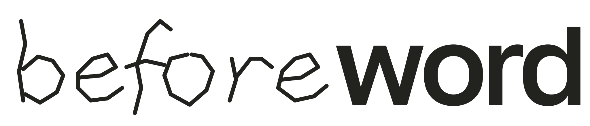

<picture>
  <source media="(prefers-color-scheme: dark)" srcset="brand/wordmark-light.svg">
  
</picture>

**English** · [Русский](README.ru.md) · [Website](https://beforeword.xyz/en/)

**A word does not become what it names.**

Beforeword is a project by **Kirill Shebetov** about learned words and descriptions of oneself, others and the world. It examines how the alphabet has replaced what is described: a written name, phrase about a feeling, explanation or result is presented as the one or the thing it names. Learning, repeating or agreeing with those words does not make that transition. Beforeword's own words receive no exception.

## The public proposal

Do not require a living being to learn, repeat, understand or accept language and descriptions of oneself, others and the world. **The party imposing the requirement removes it.** No learned refusal, explanation of refusal or replacement description is required first. Speech, writing, sign languages, communication, learning and help remain available without compulsory participation. Agreement with Beforeword is not required either.

For example, an organizer removes a mandatory “Describe yourself” field and allows the application to be submitted without it. Offering a different description would leave the requirement in place. This is a constructed example. The [full proposal](https://beforeword.xyz/proposal/en/) develops the actions and scope; the distinction between a word and what it names does not by itself prove that social proposal.

## Start here

1. **[Read the illustrated homepage](https://beforeword.xyz/en/)** — names, feelings, language, learning, records and the public proposal.
2. **[Try Text Mode](https://beforeword.xyz/text-mode/en/)** — work with supplied text using the available modes and inspect the returned answer.
3. **[Use the AI instruction](docs/ai-guide.en.md)** — full English and Russian editions, setup and downloads. The instruction asks the model to preserve wording and examine added readings, including its own explanation; practical tasks and exact requested formats remain available.
4. **[Read HUMAN](https://beforeword.xyz/research/human/en/)** — a study of how an instruction links records, descriptions and decisions.

## Packages and integrations

- **[Claude and OpenAI](catalog/README.md)** — native instruction packages, installation routes and separately recorded directory status.
- **[Chrome extension](integrations/browser/README.md)** — browser interface, source and build instructions. A locally built package and a published store version are recorded separately.
- **[Hugging Face connector](integrations/huggingface/README.md)** — retrieve the exact instruction through MCP, or request a dictionary entry with its source. This connector does not run a model.
- **[Release contract](references/release-contract.json)** — the selected source version and exact instruction hashes. [Evaluation records](evaluations/README.md) identify which version, inputs and outputs were actually checked.

The AI instruction is an application of the reading procedure. The public proposal is not an additional command imposed on every conversation. Installing a package or retrieving its text does not establish how a later answer will follow it.

## Further work

[Research, music and source material](https://beforeword.xyz/en/#materials) · [Public statement](https://beforeword.xyz/statement/en/) · [Earlier proposal](https://github.com/beforeword/words-and-decisions) · [Correspondence archive](https://github.com/beforeword/correspondence)

[Contact: mail@beforeword.xyz](mailto:mail@beforeword.xyz)

## Remote reader

The separate [Beforeword reader](integrations/mcp/README.md) keeps exact supplied writing beside a proposed reading and checks literal quotations in temporary source revisions. Its [OpenAI package](plugins/openai/beforeword-reader/) has the distinct identity `beforeword-reader`. It uses no Beforeword account and makes no model-provider calls; the current host produces the reading. This source and a personal installation do not establish public directory approval.
