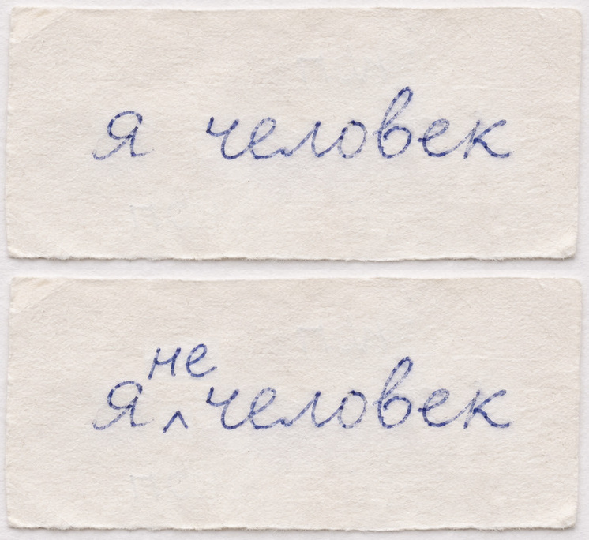

<a href="https://beforeword.xyz/">
  <picture>
    <source media="(prefers-color-scheme: dark)" srcset="https://raw.githubusercontent.com/beforeword/beforeword/main/brand/site-wordmark-dark.png">
    
  </picture>
</a>

[English](https://github.com/beforeword) · **Русский**

Меня научили писать «Кирилл Шебетов». Заполняю бланк, достаю паспорт и сверяю каждую букву. Позже, когда я один, спрашиваю себя «Кто я?» и снова открываю ту же страницу. Я проверил написание имени. Что эти буквы отвечают и на вопрос обо мне, решил я сам. Так же я могу принять запись за другого человека или за то, что видел своими глазами.

**Я предлагаю снять требование принимать выученные слова и числа за себя, за других или за сам мир.** Снять это требование может тот, кто его предъявляет. Каждый решает сам, какие слова учить и какими пользоваться. Это относится и к словам, написанным здесь.

[Прочитать предложение](https://beforeword.xyz/proposal/) · [Главная Beforeword](https://beforeword.xyz/) · [Взять инструкцию для ИИ](https://beforeword.xyz/model/#medium-details)

## Иллюстрированная книга

**[Кто решил, что слово «человек» — это я?](https://beforeword.xyz/book/)**

На одном листке я написал «я человек». На другом между теми же словами поставил галочку и вписал «не». Где появились две буквы, я могу показать пальцем. Почему я должен принять за себя хоть одну из этих записей?

[Читать по-русски](https://beforeword.xyz/book/) · [Скачать русскую книгу в PDF](https://beforeword.xyz/book/beforeword-ru.pdf)

## Фильмы, музыка и исследования

- [Посмотреть «Выученные слова»](https://beforeword.xyz/video/learned-words/) — я начинаю с шести букв своего имени и буквы «я».
- [Посмотреть мультфильмы](https://beforeword.xyz/animation/) — можно выбрать фильм и прочитать, зачем он сделан.
- [Послушать музыку](https://beforeword.xyz/music/) — мои песни, тексты и клипы.
- [Открыть исследования](https://beforeword.xyz/research/) — в работе [«ЧЕЛОВЕК»](https://beforeword.xyz/research/human/) разобрано, как письменные инструкции связывают описание человека с решением о нём.

## Как использовать Beforeword с ИИ

Инструкция предлагает модели различать слова, которые вы ей дали, и прочтение, которое она сама к ним добавила. Это относится и к собственным ответам модели. [Скопировать инструкцию или выбрать редакцию на сайте](https://beforeword.xyz/model/#medium-details) · [Прочитать полный русский текст на GitHub](https://github.com/beforeword/beforeword/blob/main/assets/core.ru.txt).

## Инструменты для чтения и исходный код

В [Text Mode](https://beforeword.xyz/text-mode/) можно дать одной модели одно и то же задание и сравнить два ответа — с инструкцией Beforeword и без неё. [Beforeword Reader (на английском)](https://beforeword.xyz/reader/) показывает исходный отрывок рядом с предложенным прочтением. Их можно сравнить слово в слово.

- [Как установить инструкцию для ИИ](https://github.com/beforeword/beforeword/blob/main/docs/ai-guide.ru.md) · [Пакеты для Claude и OpenAI и их статус в каталогах](https://github.com/beforeword/beforeword/blob/main/catalog/README.ru.md)
- [Расширение для браузера и инструкции по сборке](https://github.com/beforeword/beforeword/blob/main/integrations/browser/README.md) · [Подключение к Hugging Face](https://github.com/beforeword/beforeword/blob/main/integrations/huggingface/README.md)
- [Исходный код Reader и инструменты MCP](https://github.com/beforeword/beforeword/blob/main/integrations/mcp/README.md) · [Пакет Reader для OpenAI](https://github.com/beforeword/beforeword/tree/main/plugins/openai/beforeword-reader)
- [Версия в этом репозитории](https://github.com/beforeword/beforeword/blob/main/references/release-contract.json) · [Результаты проверок](https://github.com/beforeword/beforeword/blob/main/evaluations/README.ru.md)

## Архив и связь

[Публичное заявление](https://beforeword.xyz/statement/) · [Исследование «Слова о себе и решения по записям»](https://github.com/beforeword/words-and-decisions/blob/main/README.ru.md) · [Архив писем](https://github.com/beforeword/correspondence/blob/main/README.ru.md)

[mail@beforeword.xyz](mailto:mail@beforeword.xyz)
